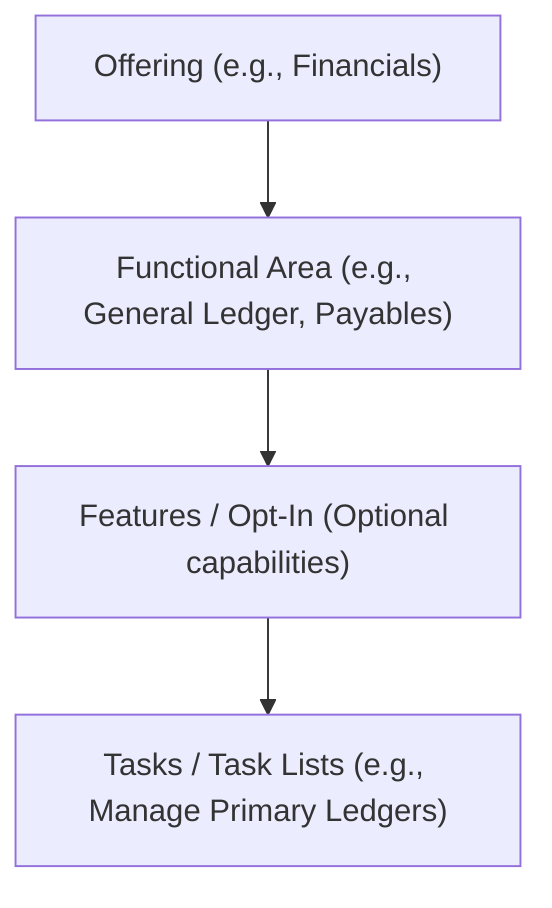

# Day 7 — Functional Setup Manager (FSM) & Implementation Projects

**Topic:** Oracle Functional Setup Manager (FSM) & Managing Implementation Projects  
**Date:** 2026-10-12  
**Time spent:** 

---

## 1. What is Functional Setup Manager (FSM)?

In older ERP systems (like Oracle EBS 11i/R12), setting up a module meant navigating through hundreds of nested menus, disparate forms, and separate responsibilities (e.g., General Ledger Super User, Payables Manager).

**Oracle Functional Setup Manager (FSM)** is the single, centralized backbone for configuring and administering **all** Oracle Fusion Cloud applications. 

### Core Benefits of FSM
1. **Single Entry Point:** Every setup screen across Financials, SCM, HCM, and Procurement lives in one place under **Setup and Maintenance**.
2. **Guided Implementation:** Provides a structured, sequential checklist of setup tasks (Task Lists).
3. **Project & Task Tracking:** Allows project managers to assign tasks to specific consultants, set due dates, and track completion progress (0% to 100%).
4. **Environment Migration (Export / Import):** Enables exporting setups from a **DEV** pod and importing them cleanly into **TEST** and **PROD** pods using Configuration Packages.

---

## 2. Key Building Blocks of FSM

Before creating a project, it is essential to understand the four-tier hierarchy Oracle uses to organize setups:

| Component | Definition | Example |
| :--- | :--- | :--- |
| **Offering** | The highest level business process or application suite. | *Financials*, *Procurement*, *Order Management* |
| **Functional Area** | Logical groupings of business functions under an offering. | *General Ledger*, *Payables*, *Receivables* |
| **Feature (Opt-In)** | Optional business capabilities you can turn ON or OFF. | *Expense Auditing*, *Multi-Currency Processing* |
| **Task / Task List** | The individual setup page or step where you enter configuration data. | *Manage Accounting Calendars*, *Manage Currencies* |

---

## 3. How to Navigate to FSM

There are two primary ways to access the FSM work area:

1. **Via User Settings & Actions:**
   - Click your **User Profile Avatar / Name** (top-right corner of the global header).
   - Under Administration, click **Setup and Maintenance**.
2. **Via Navigator (Hamburger Menu):**
   - Click the **Navigator** icon (top-left corner).
   - Scroll down to the **Others** or **Configuration** section.
   - Click **Setup and Maintenance**.

---

## 4. Managing Implementation Projects

While setups can be performed directly through the default Offerings view, real-world ERP implementations use **Implementation Projects** for governance, assignment, and configuration migration.

### Accessing Implementation Projects
1. In the **Setup and Maintenance** work area, look at the right-side vertical icon panel (the Slideout / Tasks panel).
2. Click the **Tasks** icon (looks like a clipboard or paper with lines).
3. Select the task link: **Manage Implementation Projects**.

---

## 5. Overview Screen & Assigned Projects

When the **Manage Implementation Projects** page opens:
- **Overview / My Assigned Projects:** By default, the system displays all implementation projects currently assigned to the **logged-in user**.
- If a project was created by another consultant or project lead and assigned to you, it automatically appears in this list.
- **Search:** You can clear the "Assigned To" filter or search by project name/code to view all implementation projects across the entire instance.

---

## 6. Step-by-Step: Creating a New Implementation Project

To create a brand-new implementation project:

### Step 1: Click the Create Icon
- In the table header / toolbar of the *Manage Implementation Projects* screen, click the **`+` (Create)** icon.

### Step 2: Fill in Basic Project Details
A dialog/form will appear requesting the following key fields:

| Field | Description | Example / Best Practice |
| :--- | :--- | :--- |
| **Name** | A clear, identifiable display name for the implementation project (can be edited later). | `XX_Financials_Core_Setup` |
| **Code** | A unique system identifier (alphanumeric, uppercase, no spaces). **Warning:** Once the project is created, the **Code is NOT editable**! | `XX_FIN_CORE_SETUP` |
| **Description** | Context regarding what modules and business entities this project covers (editable). | `Core Financials implementation covering General Ledger, Payables, and Cash Management.` |
| **Assigned To** | The user responsible for overseeing the project (defaults to current user, editable). | Current logged-in user / Implementation Lead |
| **Start Date** | The official kick-off or configuration start date (editable). | Current Date (e.g., `2026-10-12`) |
| **Open Date / Target Date** | (Optional) Timeline markers to help track implementation deadlines. | Scheduled Go-Live / Phase completion date |

> [!CAUTION]
> **Code Immutability Rule:** Choose your project **Code** carefully on day 1! Once you save the implementation project, the **Code field is permanently locked and non-editable**. Oracle uses this code as the master key for database tables and Configuration Packages.

### Step 3: Select Offerings and Options (The Selection Screen)

Once you click **Next**, the system navigates to the **Select Offerings to Implement** page.

1. **Locate the Offering:**
   - In the offerings table, find **Financials**.
   - Check the **Include** checkbox next to **Financials**.

2. **Select Specific Functional Areas & Modules:**
   - Expanding Financials allows you to select exactly which sub-modules/functional areas are within the scope of this project, such as:
     - **Expenses** (Employee travel & expense reimbursement)
     - **Fixed Assets (FA)** (Asset additions, depreciation, retirements)
     - **Customer Invoice Processing** (Receivables billing and customer invoicing)
     - **Collections** (Advanced collections, dunning letters, customer aging)
     - **Revenue Management** (ASC 606 / IFRS 15 revenue contract accounting)
     - *General Ledger, Payables, Cash Management*, etc.

> [!IMPORTANT]
> ### The Cardinal Rule: Offering Enablement (Opt-in Prerequisite)
> **Whatever offering is enabled at that time, ONLY that comes inside this project.**
> - Before an Offering or Functional Area can be selected in an Implementation Project, it **must be Provisioned and Enabled (Opted-in)** at the environment level under **Configure Offerings** (Opt-In Features).
> - If an Offering/Feature is not enabled in the environment at that moment:
>   - Its checkbox will either be greyed out or it will not appear.
>   - Its corresponding task list will **not** be generated inside the Implementation Project.
> - **Best Practice:** Always verify that the client's purchased and required modules are enabled in *Configure Offerings* **before** creating the Implementation Project.

3. **Finalize Selection & Generate Task List:**
   - Once all required offerings and functional areas are selected, click the button: **Save and Open Project**.
   - **What happens next:**
     - Oracle saves your project configuration and triggers a background process.
     - It compiles and expands all associated setup task lists, sub-task lists, and setup tasks into the project workspace.
     - You are immediately taken directly inside the newly created Implementation Project workbench.

---

## 7. Inside the Implementation Project (The Project Workbench)

Once you click **Save and Open Project**, Oracle presents the full **Task Hierarchy**:
- **Structured Task Hierarchy:** Displays an expandable tree structure of all setup folders organized by module, prerequisite sequence, and functional area.
- **Task Assignment:** You can select any task (e.g., *Manage Primary Ledgers*) and click **Assign** to delegate it to a specific implementation consultant.
- **Status & Progress Tracking:** Track execution status for each task (*Not Started*, *In Progress*, *Completed*), enter due dates, and view overall project % completion.
- **Direct Navigation ("Go to Task"):** Clicking the **Go to Task** button (small icon with a clipboard and arrow) launches directly into the live setup page without needing to know the underlying navigation path.

### Editing Project & Task Details (Updating Status)
- In the project view (or from the project list), click the **Edit** button (or pencil icon).
- Here, you can manage the project lifecycle:
  - Change the overall **Status** (e.g., change from *Not Started* to **In Progress** when active work begins).
  - Update **Name**, **Description**, **Assigned To**, **Target Completion Date**, or add project **Notes**.
  - **Important System Constraint:** The **Code** field is greyed out / read-only — **Code is NOT editable** once the project has been saved.
- Once the updates are made, click **Save and Close** to persist the changes.

---

## 8. Why Implementation Projects Matter for Go-Live

Beyond organizing tasks, Implementation Projects are required for **Environment Migration**:
- **Export Setup Data:** Once configuration is verified in your development instance (DEV), you generate a **Configuration Package** based on your Implementation Project.
- **Import Setup Data:** You log into TEST/UAT or PROD, upload the package, and import the entire setup automatically without manual re-keying.

---

## Hands-on / Practice Summary

- [x] Navigated to **Settings and Actions ➔ Setup and Maintenance**.
- [x] Opened the **Tasks slideout panel** and clicked **Manage Implementation Projects**.
- [x] Observed the **Overview screen** showing projects assigned to the current logged-in user.
- [x] Clicked the **`+` (Create)** icon to initialize a new project.
- [x] Defined core project metadata: **Name**, **Code**, **Description**, **Assigned To**, and **Start Date**.
- [x] Clicked **Next** to reach the **Select Offerings to Implement** page.
- [x] Selected **Financials** and examined functional areas:
  - Expenses
  - Fixed Assets (FA)
  - Customer Invoice Processing
  - Collections
  - Revenue Management
- [x] **Key Takeaway Learned:** Only offerings that are actively **enabled (opted-in)** at that time can be selected and populated inside the project.
- [x] Clicked **Save and Open Project** to save selections and immediately open the structured task hierarchy workbench.
- [x] Used **Edit** to modify project details, updated the Status to **In Progress**, and clicked **Save and Close**.
- [x] **Discovered System Rule:** Verified that the **Code** field is strictly **not editable** after the project is created.

---

## Questions / Doubts
- **What happens if we need to add another module later (e.g., Procurement or Expenses) after the project is already created?**  
  *(Answer: You can re-open the Implementation Project, click the **Add** or **Select Offerings** action, and add more offerings or individual task lists at any time — provided they are enabled in Configure Offerings).*

---

## Tomorrow (Day 8 Ideas)
- Deep dive into the **Chart of Accounts (COA)** setup tasks within the Implementation Project: Value Sets, Segment Labels, and Account Rules.

